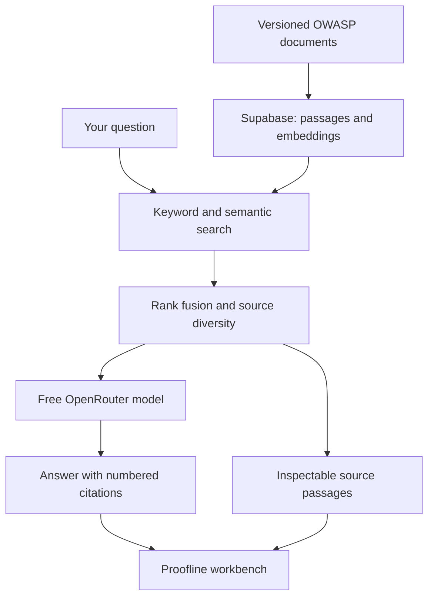
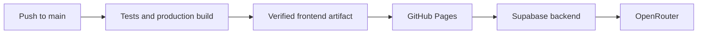

# Proofline

### AI security, with evidence.

Proofline is a retrieval-augmented generation (RAG) web app that helps developers investigate AI application security. It searches a versioned collection of OWASP guidance, generates an answer with a free language model, and shows the exact passages used to produce it.

**[Open the app](https://hafiz-fansuri.github.io/proofline/)** · [Explore the code](https://github.com/hafiz-fansuri/proofline) · [View CI/CD runs](https://github.com/hafiz-fansuri/proofline/actions)


## The problem it addresses

Developers building AI applications need to understand risks such as prompt injection, poisoned documents, excessive agent permissions, and unsafe model outputs. A generated answer is easier to assess when its sources are visible. Proofline brings source discovery, cited answers, and retrieval evaluation into one workbench.

## What you can do

| Area | What it provides |
| --- | --- |
| **Research** | Ask a security question, choose hybrid or keyword retrieval, inspect citations, and save helpfulness feedback. |
| **Source library** | Browse 11 OWASP 2026 documents with original links, pinned revisions, attribution, and stored Markdown. |
| **Evaluation** | Compare retrieval strategies on 16 authored cases, inspect results, and export benchmark runs. |
| **CI / CD** | See real GitHub workflow results and understand how changes reach the live app. |

Try asking: **“What controls reduce excessive agency in a tool-using assistant?”** Then click a numbered citation to inspect the supporting passage.

## How it works

The corpus contains **188 heading-aware passages**. Hybrid search combines keyword matching and semantic similarity using reciprocal rank fusion. Up to five passages are supplied to the model, with a limit of two passages per source document.



Questions, answers, retrieved evidence, feedback, evaluation results, and release metadata are stored in Supabase. Original source documents are also archived in Supabase Storage.

## Technology

| Layer | Technology |
| --- | --- |
| Interface | React, TypeScript, Vite, CSS, Lucide icons |
| Backend | Supabase Edge Functions |
| Data and search | Supabase Postgres, full-text search, pgvector, Storage |
| Embeddings | Normalized 384-dimensional `gte-small` vectors |
| Answer generation | OpenRouter: `particle-ai/particle-1:free`, with a bounded free fallback |
| Verification and hosting | GitHub Actions and GitHub Pages |

## How the app is published

The frontend is hosted publicly on **GitHub Pages**. The backend runs separately in **Supabase**, where the model API key is saved as an Edge Function secret.



Pull requests run verification without publishing. A push to `main` publishes only after verification succeeds. Database and Edge Function releases remain explicit owner-operated steps. See the [CI/CD walkthrough](docs/CICD.md) for the full explanation.

## Evaluating the system

The dashboard compares keyword and hybrid retrieval using **recall at five passages**, **mean reciprocal rank**, and **retrieval latency**. Runs are saved so their cases and retrieved sources can be inspected later.

The development set has 13 answerable questions and three unsupported questions. Retrieval scores measure source finding, **not answer accuracy**. Citation checks validate reference IDs; they do not prove that a passage supports a claim. The [evaluation guide](docs/EVALUATION.md) explains the measurements and how to assess answer quality independently.

## Run locally

Use Node.js 22 or newer:

```sh
npm ci
npm run dev
```

The checked-in configuration connects to the quota-limited public demo backend. For your own Supabase instance, model secrets, and corpus ingestion, follow the [setup and operations guide](docs/OPERATIONS.md).

## Scope and attribution

Proofline is a public portfolio demo. Free model availability varies; if generation fails, retrieved evidence remains available. No paid fallback is enabled. Browser sessions provide separate histories, but the app does not have account-based authentication. Do not submit confidential information.

Application code is [MIT licensed](LICENSE). OWASP source content and derived passages remain **CC BY-SA 4.0**, with formatting and chunking adaptations. The corpus is pinned to [source revision `9253e38`](https://github.com/GenAI-Security-Project/GenAI-LLM-Top10/tree/9253e38ade58e959b531c0c5c9a4842272c9cd0e/2026/final). No OWASP endorsement is implied.
