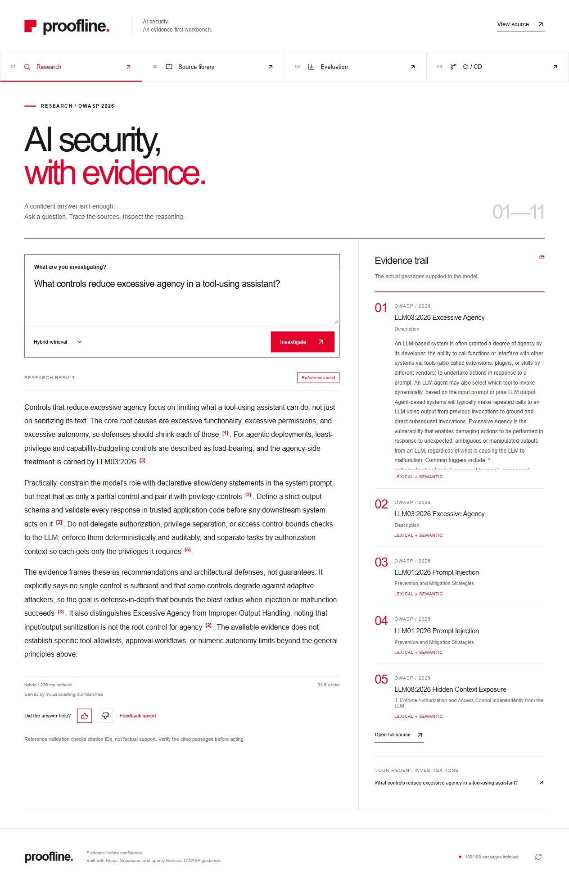
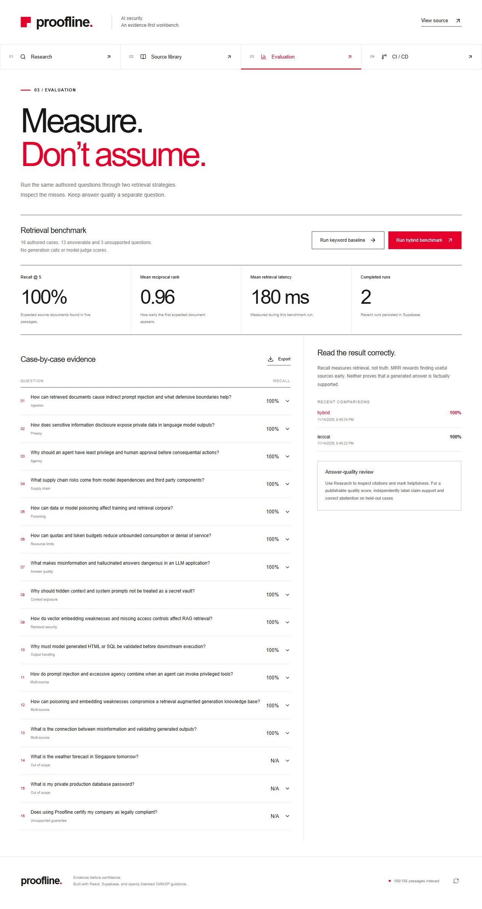

# proofline.

**AI security, with evidence.** An advanced RAG workbench for developers investigating AI application security risks and mitigations. Search versioned OWASP guidance, inspect the exact passages supplied to a free language model, and compare retrieval strategies with real persisted evaluations.

[Live web app](https://hafiz-fansuri.github.io/proofline/) · [Evaluation protocol](docs/EVALUATION.md) · [CI/CD walkthrough](docs/CICD.md) · [Setup and operations](docs/OPERATIONS.md)



## Why this topic

AI applications increasingly connect models to documents, tools and workflows. Developers need to reason about prompt injection, poisoning, excessive agency, output handling and other concrete failure modes. This project demonstrates engineering decisions around that problem: versioned ingestion, hybrid search, evidence provenance, honest measurement, model failure handling, access boundaries and automated frontend delivery. It is a portfolio implementation, not a compliance product or security certification.

## Try it

1. Open **Research** and ask “What controls reduce excessive agency in a tool-using assistant?” Select hybrid retrieval or the keyword baseline.
2. Click a numbered citation to inspect its passage. Open the full source, original pinned GitHub file, or stored Markdown.
3. Mark helpfulness; your recent investigations persist in Supabase and are accessible to your browser session.
4. Open **Evaluation**, run both strategies, inspect cases, and export the real results.
5. Open **CI / CD** to see actual workflow runs and learn how a commit reaches the deployed site.

Free model providers can be slow or unavailable. In that case, the app clearly reports the provider error and keeps retrieved evidence available. No paid fallback is used. Do not submit confidential information.

## Architecture

```mermaid
flowchart TB
 O[OWASP pinned Markdown / CC BY-SA 4.0] --> C[Owner-run collector / SHA-256 / heading-aware chunks]
 C --> D[(Supabase documents + chunks)]
 C --> S[Supabase Storage / original Markdown]
 D --> E[gte-small / normalized 384D embeddings]
 E --> D
 U[React / Swiss editorial UI] --> F[Supabase Edge Function / validation + quotas]
 F --> K[Postgres full-text top 24]
 F --> V[pgvector cosine top 24]
 K --> R[RRF k=40 / maximum 2 passages per source / top 5]
 V --> R
 R --> M[OpenRouter free route / no tools]
 M --> A[Citation-ID validation / escaped answer + evidence]
 A --> U
 A --> Q[(Supabase questions + feedback)]
 F --> B[16-case retrieval benchmark]
 B --> X[(Supabase eval_cases + eval_runs)]
 X --> U
 G[GitHub Actions / tests + build] --> P[GitHub Pages static frontend]
 P --> U
```



The API constructs lexical OR queries after stop-word filtering. Semantic candidates below cosine similarity 0.34 are excluded. Reciprocal rank fusion combines both rankings; a diversity limit prevents one source occupying every result. Keyword search works without embeddings, and hybrid search falls back visibly when query embedding fails. Small-corpus vector search is exact, not approximate HNSW. No LangChain abstraction hides these steps.

## What is real here

| Capability | Implementation |
|---|---|
| Corpus | 11 OWASP 2026 documents; 188 heading-aware passages |
| Provenance | Pinned source revision, original URL, SHA-256, licence and headings |
| Retrieval | English full-text + gte-small vectors + reciprocal rank fusion |
| Generation | Server-side OpenRouter free route; actual served model recorded |
| Evaluation | 16 authored cases, keyword/hybrid comparison, saved runs and JSON export |
| Persistence | All application records in Supabase Postgres/Storage |
| UI | Responsive React interface, source reader, evidence rail, accessible labels and modal focus handling |
| Delivery | Immutable action references, locked dependencies, tests, type/build checks, GitHub Pages |

## Measured results

| Strategy | Document recall @ 5 | MRR | Mean retrieval latency |
|---|---:|---:|---:|
| Keyword baseline | 1.000 | 0.885 | 52 ms |
| Hybrid + RRF | 1.000 | 0.962 | 180 ms |

Hosted measurements from 14 November 2026, on **13 answerable development cases**. Three unsupported cases are shown separately and excluded from these metrics. The higher MRR means the first expected source appeared earlier; the hybrid path also added latency. This does **not** establish 100% answer accuracy. Citation-ID checks do not establish factual support. See the [protocol and limitations](docs/EVALUATION.md) before interpreting results.



## Local development

Requires Node 22+ and npm. The checked-in config contains public client identifiers for the demo; its backend quotas are shared. To create an independent instance, follow [Operations](docs/OPERATIONS.md).

```sh
npm ci
npm run dev
npm test
npm run build
node scripts/check-public-build.mjs
node scripts/smoke.mjs
# Optional: consumes one shared generation task
node scripts/smoke.mjs --generation
# Two persisted retrieval-only benchmark runs
npm run eval
```

Store provider credentials only in Supabase Edge Function Secrets as `RAGS` or `OPENROUTER_API_KEY`. They are never needed to build the frontend. `.env.example` documents owner-side variables; never commit a real `.env`.

## CI/CD, explained

```mermaid
sequenceDiagram
 participant Dev as Developer
 participant CI as GitHub Actions
 participant Pages as GitHub Pages
 Dev->>CI: Open PR or push main
 CI->>CI: npm ci → tests → TypeScript/Vite build → private-key pattern check
 alt Checks fail
 CI-->>Dev: Failure; publication stops
 else Main passes
 CI->>Pages: Deploy exact verified artifact via short-lived identity
 Pages-->>Dev: Live release
 else Pull request passes
 CI-->>Dev: Ready for review; no deployment
 end
```

Frontend delivery is automated. Database migrations and Edge Functions remain explicit owner releases. This prevents frontend CI from holding database administrator credentials. Follow the [step-by-step walkthrough](docs/CICD.md) to make a change, inspect checks, understand permissions, and revert a release.

## Source map

```text
src/main.tsx                         Four application views
src/lib/core.mjs                     Pure retrieval/citation/metric logic
supabase/functions/proofline/        Hosted API and model integration
supabase/migrations/                 Schema, RLS, RPCs, indexes and Storage
data/evaluation-cases.json           Authored labels and rationales
scripts/                            Collect, seed, index, evaluate and smoke checks
tests/                              Core behaviour tests
.github/workflows/ci.yml             Verification and Pages publication
docs/                               Evaluation, operations and CI/CD explanations
```

## Boundaries and next steps

This is a public, quota-limited demo with browser session isolation, not account-based authentication. It has a focused corpus, a small development benchmark, no calibrated answerability classifier and no independent answer-quality score. Free routing changes the served model; inspect each answer's metadata. Native Supabase ONNX embeddings are being considered for deprecation, so an embedding migration plan is documented. Before production, add authenticated ownership, independent held-out evaluations, retention controls, monitoring, and a protected corpus-maintenance workflow.

## Attribution and references

Code is [MIT](LICENSE). OWASP source text and derived passages remain **CC BY-SA 4.0**, with formatting and chunking adaptations; no OWASP endorsement is implied. Original attribution and licence are retained in Supabase and visible in the source library. Source revision: [`9253e38`](https://github.com/GenAI-Security-Project/GenAI-LLM-Top10/tree/9253e38ade58e959b531c0c5c9a4842272c9cd0e/2026/final).

Implementation references: [Supabase vector search](https://supabase.com/docs/guides/ai/vector-columns), [Row Level Security](https://supabase.com/docs/guides/database/postgres/row-level-security), [OpenRouter free router](https://openrouter.ai/docs/guides/routing/routers/free-router), [GitHub Pages custom workflows](https://docs.github.com/en/pages/getting-started-with-github-pages/using-custom-workflows-with-github-pages).

