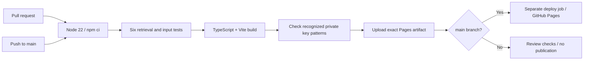

# Understanding CI/CD in Proofline

**CI** means every change is checked consistently. **CD** means a passing build on `main` is published automatically. The workflow is [ci.yml](../.github/workflows/ci.yml).



1. Work on a branch, for example `codex/improve-retrieval`. Commit a change and open a PR.
2. The `verify` job installs exactly `package-lock.json` using `npm ci`, runs tests, builds the app, and scans browser output for recognized private-key patterns. This scan is a limited guard, not a comprehensive secret audit.
3. PRs have read-only repository permissions and cannot deploy. Review the checks before merging. Branch protection is not configured automatically; a maintainer can require this check in repository rules.
4. Pushing or merging to `main` runs the same checks. The static output becomes a Pages artifact. The separate `deploy` job must wait for `verify` to pass.
5. Only the deployment job has `pages: write` and `id-token: write`. GitHub issues a short-lived deployment identity; there is no long-lived hosting token in repository secrets.
6. Open Actions, select **Verify and publish**, then inspect each job. CI/CD is an owner workflow. Inspect results in GitHub Actions; the public website has no CI/CD screen.

## What a failure means

If a test or build fails, the deploy job does not run. The previous successful site stays live. Fix the failure on the branch, push, and inspect the new run. To roll back a bad successful release, revert its commit and push to `main`; the revert goes through the same verification. Data changes need their own recovery plan.

## Backend releases are explicit

Frontend delivery is automatic. Database migrations and Edge Function deployment are versioned but intentionally owner-operated. A browser-only build never receives the Supabase service-role key or OpenRouter key.

```sh
npx supabase login
npx supabase link --project-ref YOUR_PROJECT_REF
npx supabase db push --dry-run
npx supabase db push
npx supabase functions deploy proofline
```

Review migration SQL and test against a separate project before applying to production. Existing hosted migrations applied through the connector may need migration-history reconciliation before CLI `db push`; inspect `supabase migration list` first. No automatic schema rollback is supplied.

## Reproduce locally

```sh
npm ci
npm test
npm run build
node scripts/check-public-build.mjs
```

Live API smoke tests and retrieval evaluation are separate from CI because they use shared demo quotas and a changing external service. Run `node scripts/smoke.mjs`, optionally `--generation`, and `npm run eval` before a backend release. Free-model unavailability should be reported rather than hidden by a paid fallback.
