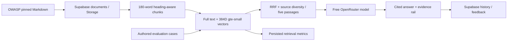

# Proofline — deployed AI security RAG

[Open the app](https://hafiz-fansuri.github.io/proofline/) · [Public repository](https://github.com/hafiz-fansuri/proofline)

Related study notes: [[AI Portfolio - Start Here]] · [[Free AI - Start Here]] · [[Free AI - Build and Evaluation Playbook]].

## What was built

An evidence-first workbench for AI application security, using 11 pinned OWASP 2026 documents and 188 indexed passages. It includes research with clickable citations, an attributed source library, an evaluation dashboard and a live CI/CD explanation. All application records persist in Supabase; the browser retains a random session token.

## Model and key

The user's `RAGS` secret is detected server-side; it is never included in GitHub or browser output. The default is `particle-ai/particle-1:free`, with a bounded `inclusionai/ling-3.2-flash:free` fallback. Paid routes are rejected. Free models can fail, throttle, change or disappear; retrieved evidence remains available. Ollama is a possible future local adapter, not connected to this hosted deployment. A hosted backend cannot reach a laptop's localhost.

## Evaluation you should understand

Two hosted development-set runs measured keyword recall@5 1.000 / MRR 0.885 and hybrid recall@5 1.000 / MRR 0.962. The set contains 13 answerable and 3 unsupported questions. Unsupported cases are excluded from recall/MRR. These figures measure source retrieval, not answer accuracy. Citation-ID checks only verify that references exist; a human must assess whether they support the claims.

Use **Evaluation** to rerun both strategies and export results. For a credible quality claim, independently author a held-out set, label claim support, citation precision/coverage, answer relevance and correct abstention, and report sample counts and provider failures. [Detailed protocol](https://github.com/hafiz-fansuri/proofline/blob/main/docs/EVALUATION.md).

## How CI/CD works here

A pull request runs `npm ci`, six tests, TypeScript/Vite build and a limited private-key-pattern check. A passing `main` commit additionally uploads the exact build artifact and deploys it to GitHub Pages with a short-lived identity. Failed checks stop publication; the previous successful deployment stays live. Database migrations and Edge Functions remain explicit owner releases, avoiding administrator secrets in frontend CI.

[Workflow](https://github.com/hafiz-fansuri/proofline/actions) · [Step-by-step CI/CD guide](https://github.com/hafiz-fansuri/proofline/blob/main/docs/CICD.md) · [Setup, data and operations](https://github.com/hafiz-fansuri/proofline/blob/main/docs/OPERATIONS.md).

## Verified and limited

Six core tests and the production build passed. Live API checks verified model output with valid citation IDs, corpus availability, blocked direct database access, session-history separation and feedback ownership. Browser checks exercised source reading, feedback, benchmark execution/drill-down and mobile overflow. GitHub Actions verification and Pages deployment both succeeded.

This is a public portfolio demo, not enterprise authentication, a compliance certificate or a security guarantee. Do not enter confidential information. Generation is capped at 20 tasks/day globally and 10/session, with up to two provider attempts/task; evaluations are capped at 12 runs/day. Supabase's native ONNX embeddings may require migration if the considered deprecation proceeds. Original OWASP content remains CC BY-SA 4.0; application code is MIT.

